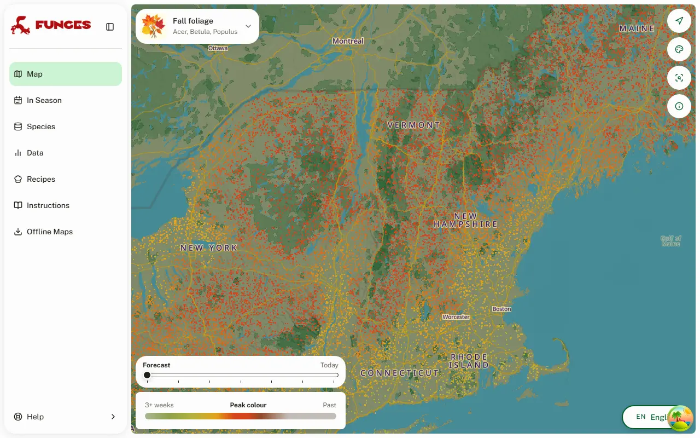
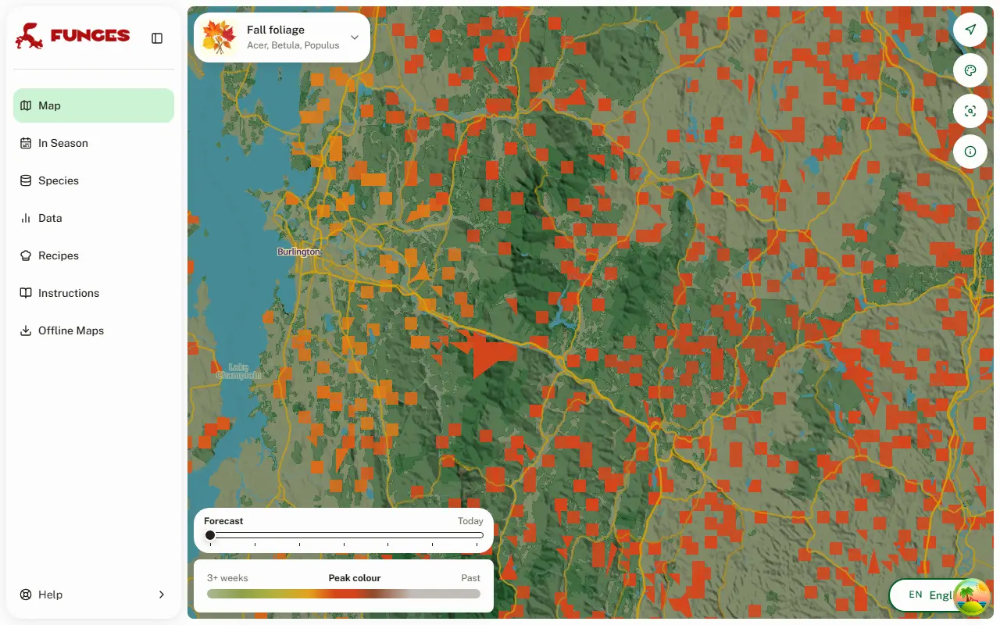

# Fall foliage: a peak-colour forecast for the US and Europe

Date: 2026-10-11 (roadmap #272, step 5)

The fifth "spectacle" layer, after [cherry blossom](2026-09-30-cherry-blossom.md), [bluebell woods](2026-10-10-bluebell.md), the [desert superbloom](2026-10-10-desert-superbloom.md) and [heather](2026-10-11-heather.md). It forecasts when the US hardwood forests, the Rocky Mountain aspens and the Pacific lowlands' oaks and maples, and Europe's beech, oak, birch and larch, reach peak autumn colour. The US sections come first; Europe has its own section. This record is its design and the evidence behind `backend/foliage.py`'s constants.

**The values below are agent-derived and wait on Loris's approval.** They come from iNaturalist records, the PhenoCam network, USA-NPN and NASA POWER temperatures; no forester has reviewed them. `backend/tools/calibrate_foliage.py` reproduces every table (`--grid` for the parameter search).

## What it looks like

11 October 2026, the forecast on the real USE master, with tiles from the production tooling served into the app locally. Northern New England and the Adirondacks are at their peak, the south still green:

The woods are the species layers' pieces, tiled as the forecast is:

## The model

Cold degree-days: from **15 August** (`START`, index 45 of a season from 1 July), each day adds how far its mean falls below **33 °C** (`BASE`); the peak is the day the sum reaches **1,031 °C·days** in the east (`REQUIREMENT`). West of 102° W the requirement depends on the cell (`requirement_of`): **897** from 1,500 m up, the aspens (`ASPEN_REQUIREMENT`); **1,247** lower down west of 116° W, the Pacific lowlands (`PACIFIC_REQUIREMENT`); and the eastern one in the interior lowlands.

- **33 °C is not a physiological threshold.** At that base nearly every day counts, so the sum is a cooling clock: about 2.5–3 days later per 1 °C warmer. The grid has a flat ridge from (1 August, 36 °C) to (1 September, 27–30 °C), and every sensitivity variant lands on it.
- **A photoperiod term adds nothing:** the day-length variant totals 25.20 against plain cold degree-days' 25.19; Delpierre's model 25.59; a photoperiod start 26.37.
- **Weather adds little over geography:** the model beats one fixed date clearly and a latitude + elevation line a little, and its year-to-year skill is weak. Treat the map as climatology plus a nudge from this year's late summer.

## Data

- **iNaturalist:** research-grade, leaf-annotated records of the colour trees (Acer, Quercus, Betula, Fagus, Populus, Liriodendron, Nyssa, Oxydendrum, Sassafras, Carya, Fraxinus, Hamamelis, Liquidambar, _Cornus florida_), US, August–December 2016–2026, evergreen oaks out: 43,985 records. A record counts as coloured if it carries "Colored Leaves".
- **The observed peak** is the median date of coloured records per POWER cell-year with ≥ 6 of them: 361 eastern cell-years in 200 cells, 270 of them from 2024–25. It falls between PhenoCam's 25%- and 10%-greenness-left days (+2.6 / −3.0 days), so it marks full colour; the 50% crossing of the coloured share runs two weeks earlier and marks onset. Split-half reliability r 0.63; weekends do not shift it.
- **Independent, never fitted on:** PhenoCam, 850 site-years at 123 deciduous broadleaf sites east of 100° W, 2008–2025; USA-NPN Nature's Notebook "Colored leaves", 2,695 site-years.
- **Temperatures:** NASA POWER daily T2M, moved to the records' median ground elevation at 6.5 °C/km.

## Tests

Mean absolute error in days:

| test                                                   |    model | one fixed date | lat + elev line | other                    |
| ------------------------------------------------------ | -------: | -------------: | --------------: | ------------------------ |
| leave one year out, 361 cell-years                     | **7.95** |          10.95 |            8.41 | cell's own median 9.87   |
| fitted elsewhere, tested on New England + New York     | **7.70** |          12.44 |            8.45 |                          |
| fitted on New England + New York, tested elsewhere     | **8.05** |          13.50 |            9.41 |                          |
| PhenoCam 25% left, own requirement, leave one year out |     9.32 |          11.85 |               – | site's own median 6.15   |
| USA-NPN ≥ 50% coloured, own requirement                |    10.31 |          12.73 |               – | site's own median 9.46   |
| aspens, own requirement, leave one year out            | **6.06** |           6.62 |            6.99 | eastern requirement 8.40 |

- **Year to year:** r 0.12 on iNaturalist and 0.31 at PhenoCam.
- **The aspens** come out +4.9 days late on the eastern requirement in every variant (+3 to +9.5), so they get their own; it rests on 26 cell-years from two autumns.
- **The western lowlands** (108 cell-years below 1,500 m in 43 cells, mostly valley oak, bigleaf maple, Oregon white oak and Fremont cottonwood): on the eastern requirement 13.9 days off and 9.4 early, 99 of them on the Pacific side, 10 days early there; the interior's 9 run 2.8 early. Their own requirement (1,247) scores 11.5 leave one year out against 11.8 for one fixed date: geography, without the bias.
- **WeatherAPI against POWER,** 1 September – 7 October 2026: +0.07 °C at 200 eastern cells (peaks +0.2 days), −0.26 °C at 19 aspen cells (−0.7 days). No correction.

**Colours:** a fresh summer green more than three weeks out (the basemap's forests are darker, so it shows), yellow and orange as the peak nears, red at it, then russet and a fading grey-brown, like the Old Farmer's Almanac's scale.

## The forecast

- **Inputs** (`backend/foliage.py`, run by `bloom.build_spectacles` from the USE and USW MapLayer scripts): the master's daily Tmax/Tmin since 1 July, including its 7 forecast days, then the POWER normals to 31 December.
- **Season:** built and shown 1 September – 30 November. Observed peaks run 20 September – 2 December (1st–99th percentile).
- **A normal year must peak by 30 November** (`LATEST_NORMAL_PEAK`): it hides Florida, the Gulf coast, south Texas and the low deserts (4.4% of USE's cells, 1.1% of USW's; 0.5% of the eastern sightings).

## The map

It is drawn on the land the species layers are drawn on. Each US MapLayer script keeps its pieces' land cover (the triangles clipped to the wilderness polygons, with their dominant NLCD class) and hands it to `build_spectacles`:

- **The woods:** pieces of deciduous and mixed forest (NLCD 41, 43). Evergreen (42) would add little (sightings within 300 m 32.9% → 36.5%) and paint the conifers.
- **The whole West** too: the aspen zone from 1,500 m (the cell's mean elevation), the Pacific lowlands and the interior, each on its requirement.
- **Each piece takes the forecast at its middle** (`bloom._sample`), on the same interpolation the bands use, rather than being cut into bands: the ground is too fine for that (419,000 polygons, 160 MB, on the wilderness polygons).
- **Simplified at 0.01° and tiled as the species forecast is** (z6, -d9, simplification 4: 3.7 MB for USE against 71 MB at the other spectacles' z10), so they look alike; the simplified multi-part pieces are mended with `buffer(0)`, which keeps 96% of the woods' area where dropping invalid ones, as the forecast does, lost three quarters.
- **Sightings:** of the eastern coloured-leaf records, 13.4% lie in a wood, 32.9% within 300 m and 57.9% within 1 km.

## Places looked at

A normal year on production's 0.1° cells:

| place                             | requirement | normal year | published typical peak                    |
| --------------------------------- | ----------- | ----------: | ----------------------------------------- |
| Stowe, VT                         | eastern     |      11 Oct | late Sep – mid Oct; best ~5–13 Oct        |
| North Conway, NH                  | eastern     |      13 Oct | first – second week of Oct (valleys)      |
| Kancamagus Pass, NH               | eastern     |       5 Oct | last week of Sep at the pass              |
| Acadia, ME                        | eastern     |      11 Oct | mid-Oct                                   |
| Berkshires (Lenox), MA            | eastern     |      12 Oct | ~4–15 Oct                                 |
| Adirondacks (Lake Placid), NY     | eastern     |       7 Oct | last days of Sep – early Oct              |
| Blue Ridge Parkway (Blowing Rock) | eastern     |      22 Oct | mid elevations 2nd–3rd week of Oct        |
| Smokies (Newfound Gap)            | eastern     |      20 Oct | above 4,000 ft early – mid Oct            |
| Upper Peninsula (Porcupine Mts)   | eastern     |       8 Oct | last week of Sep – first two weeks of Oct |
| Door County, WI                   | eastern     |      15 Oct | mid-Oct                                   |
| Ozarks (Buffalo River), AR        | eastern     |      31 Oct | late Oct – early Nov                      |
| Maroon Bells, CO                  | aspen       |      20 Sep | 22–30 Sep most reliable                   |
| Kenosha Pass, CO                  | aspen       |      20 Sep | 18–26 Sep                                 |
| Wasatch (Guardsman Pass), UT      | aspen       |      25 Sep | late Sep – early Oct                      |

Thirteen of the sixteen eastern places fall inside their published window; the misses (Kancamagus Pass, Mt Pisgah, Newfound Gap) are high sites whose 0.1° cell averages 650–970 m. All five aspen places fall inside theirs.

## Europe

Calibrated separately (`backend/tools/calibrate_foliage_eu.py`). The values wait on Loris's approval like the US ones.

### The model

- **Europe keeps the US clock, not its requirement:** cold degree-days below 33 °C from 15 August, `foliage.peak_index` unchanged. On the US requirement (1,031) European iNaturalist peaks come 14.8 days too early (20.2 days off; one fixed date 17.0).
- **Europe's peak is a later stage.** At the station networks the US requirement lands on 50% leaf colouring (DWD beech −1.5 days, MeteoSwiss −0.7), but the European peak, as people photograph it, sits at 50% leaf fall, about two weeks later.
- **Temperate requirement: 1,539 °C·days** (`EU_REQUIREMENT`). Every European source agrees: iNaturalist 1,539; DWD beech leaf fall 1,501; MeteoSwiss beech leaf fall 1,525; MeteoSwiss larch needle colouring 1,482; the published windows. Bootstrap 90%: 1,448–1,571.
- **Boreal north: 869** (`BOREAL_REQUIREMENT`; Fennoscandia's birch, rowan and aspen). On one requirement the 60–72° N cells come out 23 days late; leave one year out drops from 14.26 to 11.67 days with the two. There are no cell-years at 58–60° N, so the switch could sit anywhere in that band.
- **A ramp, not a cut** (`BOREAL_RAMP`, 15 October 2026): the requirement moves evenly from 1,539 at 54° N to 869 at 61° N. The first version cut at 60° N, which moved the peak by about four weeks from one 0.1° cell to the next (59.5° N 26 October, 60° N 29 September near Stockholm in a normal year) and drew a straight line across Norway, Sweden and Finland. The requirements stay fitted either side of 60° N; only the transition changes (`calibrate_foliage_eu.py`, section 1). Days:

  | transition        |  LOYO MAE | bias 54–60° N | bias 60–72° N | left-out cell-years 54–64° N (39): MAE (bias) | DWD beech leaf fall ≥ 53° N (3,509): MAE (bias) |
  | ----------------- | --------: | ------------: | ------------: | --------------------------------------------- | ----------------------------------------------- |
  | cut at 60° N      |     11.67 |          +8.0 |          −3.1 | 12.69 (+1.4)                                  | 8.46 (+0.3)                                     |
  | ramp 57–61° N     |     11.65 |          +8.0 |          −0.4 | 12.54 (+2.2)                                  | 8.46 (+0.3)                                     |
  | ramp 55–61° N     |     11.35 |          +5.5 |          −1.3 | 12.36 (+0.2)                                  | 8.46 (+0.3)                                     |
  | **ramp 54–61° N** | **11.15** |      **+3.1** |          −1.6 | **12.23 (−0.8)**                              | **8.40 (−0.1)**                                 |
  | ramp 54–62° N     |     11.23 |          +3.6 |          +0.7 | 12.03 (+0.7)                                  | 8.40 (−0.1)                                     |
  | ramp 52–62° N     |     11.24 |          −1.2 |          +0.0 | 11.77 (−1.3)                                  | 9.24 (−4.5)                                     |
  - **The cut ran late south of it,** 8 days at 54–60° N (the Baltics, northern Britain, southern Scandinavia: birch-rich woods on a beech requirement), and 3 days early just north of it.
  - **The left-out cell-years** are the 39 at 54–64° N with 3–5 coloured records, below the fit's 6: never fitted on.
  - **54–61° N** leaves the temperate cell-years south of 54° N as they were and fits the DWD beech stations north of 53° N as well; starting at 52° N puts those stations 4.5 days early.
  - **The 59–60° N band has no cell-years at all,** even at 3 records, so the dates there are interpolated.

  A normal year's peak at the point (normals not moved for height), cut → ramp: Edinburgh 25 → 17 Oct, Copenhagen 31 → 25 Oct, Riga 26 → 15 Oct, Gothenburg 28 → 13 Oct, Tallinn and Stockholm 26 Oct → 6 Oct, Oslo 20 Oct → 29 Sep, Helsinki 29 Sep → 3 Oct; Trondheim and Lapland unchanged.

- **The larch needs no requirement of its own,** only its own ground: its 6 alpine cell-years give 1,538 (bias −3.1 days on the temperate value), and at the stations its 50% needle colouring falls at beech's 50% leaf fall.
- **The shape held at the stations:** DWD beech leaf fall, own requirement, leave one year out 8.68 days against 8.63 for the grid's best, with the best yearly-means r (0.69). On the iNaturalist-weighted total the grid preferred a Delpierre setting by 2.8 days, but on 98 cell-years (81% from 2024–25), with a worse DWD yearly r (0.53) and a degenerate boreal requirement; the US shape was kept.

### Data

- **iNaturalist:** research-grade, Leaves-annotated records of the European colour trees (beech, the oaks, birch, the maples, larch, rowan, sweet chestnut, hornbeam, ash, aspen, wild cherry), Europe, August–December 2016–2026: 8,810 records, 2,892 coloured. 98 cell-years with ≥ 6 coloured records in 74 cells, 79 of them from 2024–25 and only 3 in Germany. Split-half reliability r 0.85.
- **DWD annual reporters,** 2000–2025: 281,490 station-years at 2,336 stations; colouring and leaf fall of beech, pedunculate oak, silver birch, horse chestnut, rowan and larch.
- **MeteoSwiss phenology** (open data): 27,832 station-years at 173 stations; 50% colouring and leaf fall of beech, larch, sweet chestnut, birch and rowan.

### Tests

| test (MAE, days)                              |            model | one fixed date | lat + elev line |
| --------------------------------------------- | ---------------: | -------------: | --------------: |
| leave one year out, two requirements          |            11.67 |          17.02 |           10.65 |
| leave one year out, one requirement           |            14.26 |              – |               – |
| temperate west → east / east → west           |      13.1 / 16.4 |    20.2 / 20.1 |     13.6 / 14.9 |
| DWD beech leaf fall (iNaturalist requirement) | 8.79 (bias +1.9) |              – |               – |
| MeteoSwiss beech leaf fall                    | 8.70 (bias +0.6) |              – |               – |
| MeteoSwiss larch needle colouring             | 9.33 (bias +3.9) |              – |               – |

- **Year to year:** DWD's yearly means r 0.69–0.80, within a station about 0.2; iNaturalist cannot test it (16 cell-years in cells with ≥ 3 years).
- **WeatherAPI against POWER,** 1 September – 7 October 2026: −0.19 °C (peaks −0.5 days). No correction.
- **Season:** 1 September – 30 November, as in the US. The 30 November cutoff hides 2.4% of the cells with broadleaf or mixed ground (Mediterranean lowlands), 0.2% of the sightings.

### The map

The European MapLayer scripts hand over their land-cover pieces too (CORINE classes):

- **Broadleaf and mixed woods (311, 313),** and **the larch:** coniferous pieces (312) whose middle lies in a host-cover cell where larch is at least a tenth of the trees (`backend/generated/larch_mask_EU.npz`, 1,998 cells of 0.05°, built offline), or in the Alps (5–16.5° E, 43.5–48.2° N) where the cell's mean elevation at the middle is 1,300 m or more. The host cover alone is too thin there: larch sightings sit at a median share of 5%, the Dolomites at 2%. All of 312 would add 279,000 km² of spruce for 7 points of sightings.
- **Sightings:** of the coloured records, 9.5% lie in a drawn piece, 17.4% within 300 m and 31.1% within 1 km (European records are urban: 31% within 1 km against the US's 58%); of the larch's, 21.5% / 33.2% / 48.4%, against 8.1% / 11.7% / 22.0% without the larch rule. The calibration read the middle's elevation from EU-DEM; production reads its cell's mean, as the US aspens do.

### Places looked at (a normal year)

| place                     | predicted | published                          |
| ------------------------- | --------: | ---------------------------------- |
| Black Forest (Feldberg)   |    23 Oct | mid – late Oct                     |
| Bavarian Forest (Lusen)   |    18 Oct | mid – late Oct                     |
| Vosges (Gérardmer)        |    27 Oct | mid – late Oct                     |
| Fontainebleau             |     5 Nov | mid Oct – early Nov                |
| Ardennes (La Roche)       |    27 Oct | mid Oct – early Nov                |
| Perthshire (Dunkeld)      |    10 Oct | October; mid Oct                   |
| Lake District (Grasmere)  |    18 Oct | mid Oct – early Nov                |
| Engadin (St. Moritz)      |    11 Oct | mid Oct (2025: 16 Oct)             |
| South Tyrol (Seiser Alm)  |    18 Oct | from mid Oct                       |
| Dolomites (Cortina)       |    20 Oct | mid Oct – early Nov (2025: 20 Oct) |
| Ticino (Valle Maggia)     |    17 Oct | 10 Oct – 15 Nov                    |
| Cévennes (Florac)         |    30 Oct | late Oct                           |
| Picos de Europa (Liébana) |    21 Oct | 1st – 3rd week Oct                 |
| Lapland (Saariselkä)      |    18 Sep | ~ 2nd week Sep                     |

15 of 23 places fall inside their window and two more at its late end (Perthshire and the Lake District moved 10 and 2 days earlier with the boreal ramp; Perthshire is now early in its October window). The misses: high alpine cells whose base points average far above the larch belt (Pontresina 2,741 m, Evolène 2,771 m) come out 10+ days early; Plitvice (10 days late) and Monte Generoso (8) rest on weak sources; Lapland's Levi is 2–5 days late, where birch alone would want less still.

### Caveats

- **A thin target:** 98 cell-years, 79 from 2024–25; the year-to-year evidence comes from the stations alone.
- **The stage:** if the map should mean "colour well under way" rather than "at its fullest", the European requirement drops toward 1,100, about two weeks earlier.
- **West against east:** the maritime west wants about 200 °C·days more than the continental east; one temperate requirement costs roughly ±9 days there.
- **2026 is not in the fit:** by 10 October only 7 cell-years, 6 of them in Finland. PhenoCam's 39 European sites were not fetched.

### Sources (Europe)

1. iNaturalist API v2 observations (place 97391; term 36, value 39).
2. DWD Climate Data Center, phenology, annual reporters, wild plants: <https://opendata.dwd.de/climate_environment/CDC/observations_germany/phenology/annual_reporters/wild/>
3. MeteoSwiss open data, phenological observations: <https://data.geo.admin.ch/api/stac/v1/collections/ch.meteoschweiz.ogd-phenology>
4. Published windows: Rough Guides (Black Forest), VisitScotland (Perthshire), the Swiss National Park and Graubünden (Engadin larches), PeakVisor's 2025 larch peaks (<https://peakvisor.com/en/news/golden-larch-season-2026-alps.html>), dolomiti.it, ticino.ch (the foliage train), Visit Finland and Metsähallitus (ruska); the full list with URLs is in the calibration's write-up.

## Caveats (the US)

- **The target is noisy** and clusters in 2024–25; the year-to-year evidence rests on PhenoCam (r 0.31).
- **Drought browning, an early frost or a windstorm** can end a season early; nothing here sees them.
- **Elevation:** a cell's mean decides, so high overlooks in the southern Appalachians come out 5–10 days late and low valleys in mountain cells early.
- **2026 is not in the fit:** by 10 October only 5 eastern cell-years had ≥ 6 coloured records.

## Rechecks, autumn 2026 and 2027

- **After 30 November 2026:** refetch iNaturalist 2026 and PhenoCam's final 2026 transitions, and test 2026 as a held-out year.
- **The aspen requirement** with 2026's Colorado and Utah records.
- **WeatherAPI against POWER** over a full September – November.
- **The high-elevation lag:** each wood with its own height instead of its cell's mean.

## Sources (the US)

1. Go Stowe, Stowe fall foliage: <https://gostowe.com/blog-stowe-fall-foliage-facts>; Visit Vermont, Fall Foliage: <https://www.visit-vermont.com/state/foliage/>
2. Kancamagus Highway, Fall Foliage: <https://kancamagushighway.com/fall-foliage-on-kancamagus-highway-nh-fall-foliage/>
3. NPS Acadia, Weather: <https://www.nps.gov/acad/planyourvisit/weather.htm>
4. Berkshire Eagle (DCR), peak foliage in the Berkshires: <https://www.berkshireeagle.com/news/local/berkshire-pea-fall-foliage/article_91795530-b3ee-4a19-affc-29c04c2d34b9.html>
5. Fall Photo Guide, New York: <https://fallphotoguide.com/foliage/new-york/>; Visit Catskills, Fall: <https://visitcatskills.com/fall/>
6. Blue Ridge Parkway Foundation, Fall Color Guide: <https://www.blueridgeparkway.org/plan-your-parkway-trip/stories-guides/fall-color-on-the-parkway/>
7. NPS Great Smoky Mountains, Fall Colors: <https://www.nps.gov/grsm/planyourvisit/fallcolor.htm>
8. UP Travel, Fall Color Reports: <https://www.uptravel.com/outdoors-recreation/fall-colors/>; Door County Visitor Bureau, Fall: <https://www.doorcounty.com/fall/>
9. Buffalo Outdoor Center, Buffalo River fall colour: <https://www.buffaloriver.com/buffalo-river-fall-color-guide-buffalo-outdoor-center/>
10. Aspen Chamber, Fall Foliage and Maroon Bells: <https://aspenchamber.org/things-to-do/trip-highlights/fall-foliage/>; Explore Park County, Kenosha Pass: <https://exploreparkcounty.com/kenosha-pass-a-kaleidoscope-of-colors-in-colorados-fall-foliage/>; Visit Utah, Leaf Peeping Scenic Byways: <https://www.visitutah.com/articles/leaf-peeping-utah-scenic-byways>
11. Models: Delpierre et al. 2009, Agric. For. Meteorol. 149: 938–948; Jeong & Medvigy 2014, Global Ecol. Biogeogr. 23: 1245–1254.
12. Data: iNaturalist API (v2 observations, v1 controlled terms); NASA POWER daily point API and 1991–2020 climatology; PhenoCam transition dates (<https://phenocam.nau.edu/>); USA-NPN observations API (<https://services.usanpn.org/npn_portal/observations/getObservations.json>); HydroSHEDS 3″ DEM; the app's USE and USW wilderness polygons.
