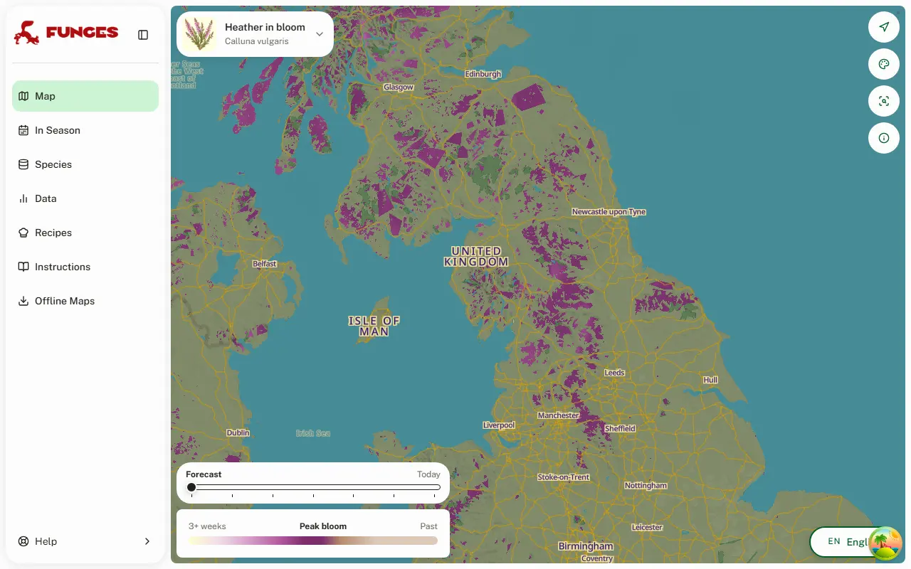
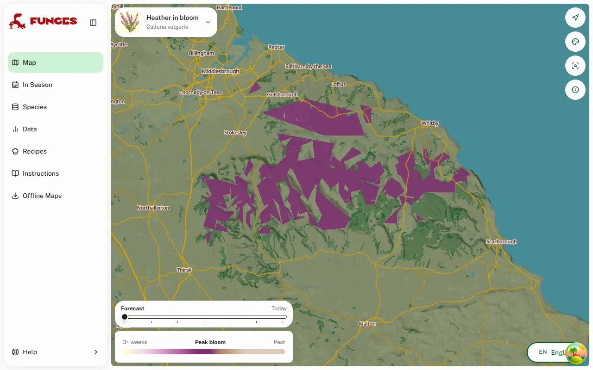
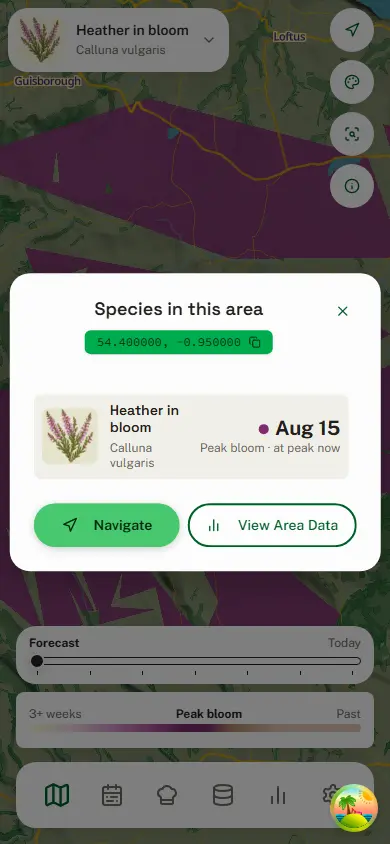

# Heather in bloom: a peak-bloom forecast

Date: 2026-10-11 (roadmap #272, step 5)

The fourth "spectacle" layer, after [cherry blossom](2026-09-30-cherry-blossom.md), [bluebell woods](2026-10-10-bluebell.md) and the [desert superbloom](2026-10-10-desert-superbloom.md). It forecasts when heather (_Calluna vulgaris_) turns the moors and heaths purple. This record is its design and the evidence behind `backend/heather.py`'s constants.

**The values below are agent-derived and wait on Loris's approval.** They come from iNaturalist records, the German weather service's phenology network and press reports; no botanist has reviewed them. `backend/tools/calibrate_heather.py` reproduces every table (`--grid` for the parameter search).

## What it looks like

15 August 2026, replayed on the real NE and SE masters, with tiles from the production tooling served into the app locally. The moors of northern England and Scotland at their peak:

The North York Moors are CORINE blanket bog, fetched for Britain and Ireland:

## The model

Heather keeps hardly any thermal clock. Across Europe, from Portugal to Iceland and from sea level to 2,000 m, it peaks around **19 August**, and every degree-day model loses to one fixed date (leave one year out: the best plain degree-days 17.0 days, photothermal and photoperiod variants 16–19, one fixed date 11.0).

What the weather adds is the year. The peak is the normal-year date, `NORMAL_PEAK` (19 August, everywhere), moved by **K = 0.25** of the season's lead: how much earlier or later this year's degree-days above **0 °C** since **1 March** reach their normal sum at 19 August. Two independent sets agree on that share: iNaturalist 0.26, DWD 0.34.

## Data

- **iNaturalist, taxon 119450** (_Calluna vulgaris_ and its infraspecific taxa; _Erica_ never enters). Research grade, Europe, June–October 2016–2026, not obscured, accuracy ≤ 1 km or unknown: 41,703 records.
- **The observed peak** is the median of July–September records not annotated as budding, fruiting or without flowers, per POWER cell-year with ≥ 8 records: 916 cell-years in 370 cells. Heather is evergreen and recorded all year, so it needs a window. On the 16 cell-years with ≥ 8 flowering-annotated records it runs +0.0 days from their median (r 0.98); the annotation alone is too thin (19 cell-years).
- **DWD annual reporters, "Heidekraut, Blüte Beginn"**, 2000–2025: 14,652 station-years at 1,412 stations. It is first flowering, about 10 days before the peak, so its tests use their own constants.
- **Press:** the Lüneburger Heide GmbH bloom barometer and dpa, 2021–2026, with two declared peaks; the Veluwe's first purple, 4 years.
- **Temperatures:** NASA POWER daily T2M, moved to the records' median EU-DEM elevation at 6.5 °C/km.

## Tests

Mean absolute error in days:

| test                                                      |             model | one fixed date | lat + elev line |
| --------------------------------------------------------- | ----------------: | -------------: | --------------: |
| leave one year out, 916 cell-years                        |             10.77 |          10.97 |           10.47 |
| fitted on GB + IE, tested on the continent                |              11.1 |           11.3 |            25.2 |
| DWD first flowering, 14,652 station-years (own constants) |          **8.66** |           8.81 |            8.84 |
| DWD yearly means, 26 years                                | **1.23** (r 0.79) |           2.12 |               – |
| Lüneburg Heath early bloom, 6 years (own constants)       |  **3.6** (r 0.81) |            6.2 |               – |
| Lüneburg Heath declared peak, 2024 and 2026               |      2 days early |              – |               – |

- **The latitude + elevation line** fits best in sample but fails transfer (25 days off on the continent when fitted on Britain and Ireland), and its slope says uplands bloom earlier: observer effort, not biology.
- **iNaturalist medians are noisy:** a cell's own median in its other years scores 10.93, worse than one fixed date, so iNaturalist ranks model families but cannot tune within one. The start, base and share were chosen on DWD, the cleanest year-to-year series.
- **Sensitivity:** every variant picks the same model, with the normal date 18–23 August and the share 0.17–0.37: June–October or 1 August–15 September records, (Tmax + Tmin) / 2, no elevation adjustment, sea cells kept, strict accuracy, ≥ 15 records.
- **WeatherAPI** runs 0.49 °C below POWER in June–September; that moves 2026's peaks by only +1.1 days, so it is left uncorrected.

## The forecast

- **Inputs** (`backend/heather.py`, run by `bloom.build_spectacles` from the NE and SE MapLayer scripts): the master's daily Tmax/Tmin since 1 January, including its 7 forecast days, then the POWER normals to 31 October. `build_peaks` hands the model the normals-only year too, which the lead is measured against.
- **Season:** built and shown 1 July – 30 September. Predicted peaks fall 13–19 August (5th–95th percentile, 2016–2026); 2026 came out 11–17 August.
- **The map looks almost uniform:** about a week of spread in a year. That is what the evidence supports.

## The map

Cells are drawn on moors and heaths (`backend/generated/heather_moors_EU.parquet`, built offline):

- **Moors and heaths:** CORINE 322 of the NE and SE wilderness polygons, the land cover the species layers are drawn on. It is 2–8 times denser in sightings than any other class; adding 321, 324 or 333 triples the area for 1.6–3.8 points more sightings.
- **Blanket bog in Britain and Ireland:** most of their heather moors (the North York Moors, the Peak District) are mapped as CORINE 412, which the wilderness polygons lack. It is fetched from the EEA's CORINE 2018 map service (4,129 polygons) and simplified to the wilderness polygons' grain.
- **Range:** kept whole where the polygon's middle has Calluna's share of plant records within 50 km at least 0.1 of its typical share (the `build_range_priors.py` machinery).
- **North of 58° N, only below 300 m:** higher is fjell heath (2–11 sightings per 1,000 km², against 38.5 below).
- **The result:** 15,004 heaths, 71,063 km². 7.2% of the sightings lie on one, 11.3% within 300 m, 17.3% within 1 km: heather lives mostly under pine and in heaths below CORINE's 25 ha minimum. Most named heaths are on the ground or within 1 km (Wilsede, the Ginkelse Heide, the Kalmthoutse Heide, Stanage, Dartmoor, Exmoor, Sally Gap, Rebild Bakker in; Goathland 0.1 km, Cannock Chase 0.5 km); the Cairngorms (2.1 km), Glen Coe (3.3 km) and the Monts d'Arrée (3.2 km) are near, and Mols Bjerge (70 km) is not mapped as heath.

Within the heaths, each 0.1° cell's peak is interpolated to 0.02° and banded in quarter days, and the layer sits under the basemap's sea and lakes.

## Places looked at

| heath                         | normal year | 2026 (POWER) | published                                     |
| ----------------------------- | ----------: | -----------: | --------------------------------------------- |
| Lüneburg Heath: Wilsede       |      19 Aug |       16 Aug | 8 Aug – 9 Sep; mostly the last week of August |
| Veluwe: Ginkelse Heide, Ede   |      19 Aug |       15 Aug | mid-August – mid-September                    |
| Kalmthoutse Heide             |      19 Aug |       15 Aug | August – September                            |
| Cannock Chase                 |      19 Aug |       14 Aug | August – October                              |
| Peak District: Stanage Edge   |      19 Aug |       15 Aug | peak colour mid-August                        |
| North York Moors: Goathland   |      19 Aug |       16 Aug | mid to late August into September             |
| Dartmoor (Haytor)             |      19 Aug |       14 Aug | late August best                              |
| Cairngorms (Glenmore)         |      19 Aug |       16 Aug | August, into September                        |
| Wicklow Mountains (Sally Gap) |      19 Aug |       15 Aug | mid-August – early September                  |
| Rold Skov / Rebild Bakker     |      19 Aug |       17 Aug | 2019: in flower 16 August to about the end    |

## Caveats

- **Regional misses, too thin to fit yet:** Portugal peaks around 6 September (the model 16 days early); Russia around 8 August (8.6 days late); Germany and the Benelux run 3–8 days later than predicted.
- **Drought, not heat, can be the story:** 2018, 2022 and 2026 suppressed or delayed flowering in places (the Veluwe's first purple only on 10 August 2026), while the temperature model calls those summers early. A rain term, as the superbloom's, is untested.
- **The east** (Russia, Belarus, Ukraine: 15% of sightings) has no CORINE and no EU-DEM, so none of it is drawn.

## Rechecks, summer 2027

- The 2027 iNaturalist medians against the forecast, especially Portugal, Russia, Finland and Germany; decide then whether regional dates are worth it.
- The Lüneburger Heide barometer and the Veluwe's first purple, to extend the series by a year; DWD's 2026 and 2027 reports.
- WeatherAPI against POWER over a full season from 1 March.
- Whether the blanket bog draws the Pennines and the Scottish moors right.

## Sources

1. Lüneburger Heide GmbH, Heideblüten-Barometer: <https://www.lueneburger-heide.de/natur/artikel/3452/heideblueten-barometer.html>; Heideblüte page and FAQ: <https://www.lueneburger-heide.de/heidebluete>
2. Naturpark Lüneburger Heide, Heideblüte: <https://www.naturpark-lueneburger-heide.de/natur-und-kultur/heide/heidebluete>
3. Veluwe: Omroep Gelderland, Staatsbosbeheer, bezoek-ede.nl (Ginkelse Heide), hogeveluwe.nl; NatureToday (first flowering means): <https://www.naturetoday.com/intl/nl/nature-reports/message/?msg=18126>
4. Natuur en Bos, Kalmthoutse Heide: <https://www.natuurenbos.be/natuurgebieden/kalmthoutse-heide>
5. Cannock Chase AONB, common heather: <https://www.cannockchase.org.uk/common-heather/>
6. Dartmoor Preservation Association: <https://www.dartmoorpreservation.co.uk/photographing-dartmoors-heather/>
7. Visit Forres, heather: <https://visitforres.scot/all-around-the-blooming-heather/>; Cairngorms NP moorlands: <https://cairngorms.co.uk/discover-explore/landscapes-scenery/the-moorlands/>
8. Naturstyrelsen, "Lyngen blomstrer ekstraordinært i år" (2019): <https://naturstyrelsen.dk/nyheder/2019/august/lyngen-blomstrer-ekstraordinaert-i-aar>
9. National Trust, Dunwich Heath: <https://www.nationaltrust.org.uk/services/media/dunwich-heather-back-in-bloom-after-remarkable-recovery>
10. Data: iNaturalist API v2 (taxon 119450); DWD Climate Data Center, phenology, annual reporters, wild plants (<https://opendata.dwd.de/climate_environment/CDC/observations_germany/phenology/annual_reporters/wild/>); NASA POWER daily point API and 1991–2020 climatology; GBIF occurrence density tiles (taxon 2882482, Plantae 6); EEA CORINE Land Cover 2018 (<https://image.discomap.eea.europa.eu/arcgis/rest/services/Corine/CLC2018_WM/MapServer>); Copernicus EU-DEM v1.1.
